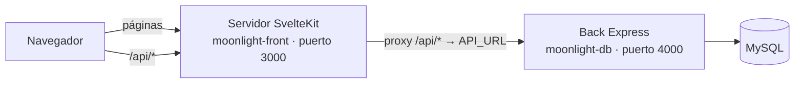

# Moonlight · Front (`moonlight-front`) — Trabajo realizado

Migración del front de Moonlight Karaoke & Social Lounge (antes HTML/CSS/JS sin framework) a **SvelteKit + TypeScript + Tailwind CSS + Redux Toolkit + axios**. Se conservaron todas las funciones, la identidad
visual neón y las animaciones del front anterior, y se agregó lo necesario para desplegarlo en Vercel.

- **Tamaño:** 57 archivos de código, unas 3,400 líneas (`src/`), 16 pantallas.
- **Estado:** compila sin errores (`npm run check`: 0 errores, 0 advertencias) y genera build de producción.
- **El back (`moonlight-db`, Express + Prisma + MySQL) no cambió su API:** el front nuevo usa exactamente las mismas rutas.

---

## 1. Tecnologías y versiones

| Tecnología | Versión | Para qué se usa |
|---|---|---|
| **SvelteKit** | 3.0.1 | Framework: rutas, servidor, compilación |
| **Svelte** | 5.57 | Componentes con *runes* (`$state`, `$derived`, `$effect`, `$props`) |
| **TypeScript** | 6.0 | Tipado de todo el código y de las respuestas de la API |
| **Vite** | 8.3 | Servidor de desarrollo y empaquetado |
| **Tailwind CSS** | 4.3 (`@tailwindcss/vite`) | Estilos con utilidades; la paleta de la marca vive en el tema |
| **Redux Toolkit** | 2.13 | Estado global (sesión, catálogo, reserva, mis reservaciones, avisos) |
| **axios** | 1.20 | Llamadas a la API (cookies de sesión + token CSRF) |
| **@sveltejs/adapter-node** | 6.0 | Servidor Node propio (`npm run build && npm start`) |
| **@sveltejs/adapter-vercel** | 7.0 | Despliegue en Vercel (se activa solo al compilar en Vercel) |
| **svelte-check** | 4.7 | Verificación de tipos (`npm run check`) |

Requiere **Node.js 22.17 o superior**.

> **Nota sobre SvelteKit 3** (versión mayor reciente, distinta a la 2):
> - La configuración de Kit va dentro de `sveltekit({...})` en `vite.config.ts`; ya **no existe** `svelte.config.js`.
> - El alias `$lib` se eliminó: se usan *subpath imports* → `import x from '#lib/...'` (definidos en `package.json` → `imports`).
> - Las variables de entorno se declaran en `src/env.ts` con `defineEnvVars` y se leen desde `$app/env/private`.

---

## 2. Arquitectura



### Decisiones principales
1. **Proxy `/api/*` hacia el back** ([`src/hooks.server.ts`](src/hooks.server.ts)).
   El servidor de SvelteKit reenvía toda petición a `/api/...` al back definido en `API_URL`. Para el navegador todo vive
   en **un solo dominio**, así que las cookies de sesión `HttpOnly` (`SameSite=Strict`) y el token CSRF funcionan igual
   que antes, **sin abrir CORS**. El proxy también reenvía la IP real del visitante (`X-Forwarded-For`) para que el back
   aplique bien sus límites de peticiones, y envía `ngrok-skip-browser-warning` para funcionar detrás de ngrok.
2. **Renderizado en el navegador** (`ssr = false` en [`src/routes/+layout.ts`](src/routes/+layout.ts)).
   Con Redux, un store en el servidor se compartiría entre usuarios y podría filtrar sesiones; así cada navegador tiene
   el suyo. (Se puede activar SSR para las páginas públicas más adelante si se busca mejor SEO.)
3. **Dos sesiones independientes** (cliente y personal), cada una con su propio token CSRF
   ([`src/lib/api/client.ts`](src/lib/api/client.ts)). Iniciar sesión en el sitio no cierra el panel y viceversa.
4. **Redux conectado a Svelte** con `seleccionar(selector)` ([`src/lib/store/index.ts`](src/lib/store/index.ts)):
   convierte una parte del estado en un *store* de Svelte, y los componentes se actualizan solos con `$valor`.
   Las listas propias de cada pestaña del panel (barra, salas, limpieza…) son estado local de su página.

---

## 3. Estructura de carpetas

```
moonlight-front/
├── public/img/              Fotos, logotipos e íconos (se sirven en /img/...)
│   ├── salas/               pequena.jpg, mediana.jpg, premium.jpg
│   └── lugar/               fachada.jpg, bar.jpg
├── src/
│   ├── app.html / app.css   Plantilla HTML y estilos (Tailwind + tema de la marca + animaciones)
│   ├── env.ts               Variables de entorno (API_URL) con validación
│   ├── hooks.server.ts      Proxy /api/* → back y encabezados de seguridad
│   ├── lib/
│   │   ├── api/             client.ts (axios, CSRF, sesiones) · types.ts (tipos de la API)
│   │   ├── store/           Redux: catalogo, sesion, reserva, mis, ui (+ index con seleccionar())
│   │   ├── components/      Modal, Avisos, Confirmación, Badge, SelectorMenu, Progreso, Cielo, Rotador…
│   │   │   ├── sitio/       AuthModal, PagoModal, TarjetaForm, EstadoCuenta
│   │   │   └── staff/       DetalleReservacion, Mostrador, MetodoPago, permisos por rol
│   │   ├── fx/              Efectos (aparición, inclinación 3D, ondas, contadores, confeti) y sonido
│   │   └── utils/           Formato (MXN, hora de México), estados, carta/horario, validación de tarjetas
│   └── routes/
│       ├── (sitio)/         Sitio de clientes: inicio, salas, menu, reservar, mis-reservaciones
│       └── staff/           Panel: recepcion, agenda, barra, salas, limpieza, finanzas
├── vite.config.ts           Configuración de SvelteKit, adaptadores, CSP y carpeta public/
├── .env / .env.example      API_URL (host del back)
└── README.md                Guía de uso
```

---

## 4. Funciones

### Sitio de clientes
| Ruta | Qué hace |
|---|---|
| `/` | Hero con el logotipo neón, "Esta noche suena…" con los géneros, datos animados, pasos, tipos de sala con foto, misión/visión, ubicación con mapa |
| `/salas` | Listado de las 15 salas con foto, precio, estado (lista / limpieza / mantenimiento) y filtro por tamaño |
| `/menu` | Carta completa (57 productos): paquetes por tipo de sala, botellas (+18), refrescos y botanas; aviso de cortesía Premium |
| `/reservar` | Asistente en 4 pasos: **sala y horario** → **música** (género o "mi propia lista" con mínimo 3 artistas, y canciones) → **alimentos y bebidas** (paquetes recomendados para la sala, botella de cortesía en Premium) → **confirmar y pagar** (anticipo con tarjeta guardada o nueva; pago simulado). Resumen con importes animados y confeti al confirmar |
| `/mis-reservaciones` | Estado en vivo (cuenta regresiva para pagar o para llegar, progreso de la visita), pagar, reagendar, cancelar (con reembolso según reglas), pedir a la sala, cambiar música y estado de cuenta |

**En segundo plano** (en cualquier página del sitio): se revisan las reservaciones cada 20 s y se avisa al cliente del
check-in, de pedidos en preparación o entregados, del tiempo ampliado, de 10 y 5 min restantes, del fin del tiempo y del
cierre de cuenta (con su desglose). Si la sesión se cierra por inactividad, se le avisa.

### Inicio de sesión unificado
Un solo formulario para todos: el back (`POST /api/acceso/login`) revisa si el correo y la contraseña son del
personal o de un cliente y abre la sesión que corresponde. Desde el botón "Iniciar sesión" del sitio o desde `/staff`:
el personal termina en el panel y el cliente en "Mis reservaciones". Mantiene las protecciones de antes (mismo mensaje
y mismo tiempo de respuesta exista o no la cuenta, bloqueo tras 5 intentos, un solo intento contra el límite por IP).
Las direcciones del front anterior (`/staff.html`, `/index.html`) redirigen a las nuevas.

### Panel del personal (`/staff`)
Pestañas según el rol (ADMIN ve todas):

| Pestaña | Roles | Qué hace |
|---|---|---|
| Recepción | Recepción, Operaciones | Buscar por número de reservación; check-in (cobrando el resto de la sala si aplica), no-show, tiempo extra, agregar pedido, cerrar cuenta (con desglose y promo); cliente sin registro; pedidos anticipados por cobrar |
| Agenda | Recepción, Operaciones, Finanzas | Reservaciones del día con su música; clic para abrir en recepción |
| Barra | Barra, Recepción | Pedidos en vivo cada 15 s, aviso sonoro de pedidos nuevos, cronómetro de espera (rojo a los 15 min) |
| Salas | Operaciones, Recepción, Limpieza | Estado de las 15 salas, visita en curso con progreso y música, próxima reservación, mantenimiento |
| Limpieza | Limpieza, Operaciones | Tareas en vivo con cronómetro y aviso sonoro |
| Finanzas | Finanzas | Ingresos netos, reservaciones por estado y pagos por tipo y método |

---

## 5. Diseño y efectos
- **Paleta del logotipo** en el tema de Tailwind: morado neón `#b45cff`, dorado `#ffc23d`, fondo casi negro
  (utilidades como `text-gold`, `bg-card`, `border-line`, `text-shadow-neon`). Tipografías **Cinzel** (títulos) y **Poppins**.
- **Efectos** (se desactivan solos si el sistema pide "reducir movimiento"): cielo estrellado con estrellas fugaces,
  aparición escalonada al hacer scroll, inclinación 3D de tarjetas, ondas en botones, contadores animados,
  texto que se escribe, logotipo que flota y parpadea como neón, ecualizador, confeti y aviso sonoro.
- **Responsivo:** en celular el menú pasa a una fila desplazable y el resumen de la reserva va debajo.

---

## 6. Seguridad
- Cookies de sesión `HttpOnly` gestionadas por el back; el front nunca las lee.
- Token CSRF por sesión en cada petición que modifica datos, con renovación automática si caduca.
- **CSP** configurada en SvelteKit (`vite.config.ts`), equivalente a la del back: scripts solo propios (con nonce),
  imágenes propias, fuentes de Google y el mapa de Google como únicas excepciones.
- Encabezados extra: `X-Content-Type-Options`, `Referrer-Policy`, `Permissions-Policy` y HSTS en HTTPS.
- Todo el texto se muestra con el escapado de Svelte (sin `innerHTML`).
- El pago con tarjeta es **simulado**: se valida como una pasarela (Luhn, marca, vencimiento, CVV), pero no se cobra;
  de una tarjeta guardada solo se conservan marca, últimos 4 dígitos y vencimiento.

---

## 7. Configuración

### Variables de entorno (`moonlight-front/.env`, no se sube a git)
```env
API_URL=http://localhost:4000     # host del back (sin "/" al final)
```
Se valida al arrancar ([`src/env.ts`](src/env.ts)). En producción (adapter-node) además: `PORT`, `ORIGIN`
y, si hay proxy delante, `ADDRESS_HEADER` / `XFF_DEPTH` / `PROTOCOL_HEADER` (ver `.env.example`).

### En el back (`moonlight-db/.env`)
`ALLOWED_ORIGINS` debe incluir la dirección del front: `http://localhost:3000` en local, o la de Vercel en producción.

---

## 8. Cómo correrlo en local
```powershell
# 1) Docker Desktop abierto. Back:
cd "C:\Users\Usuario\Documents\Johana 3\moonlight-db"
npm run db:up
npm run dev                      # API en http://localhost:4000

# 2) Front (otra terminal):
cd "C:\Users\Usuario\Documents\Johana 3\moonlight-front"
npm install                      # solo la primera vez
npm run dev                      # http://localhost:3000  ·  panel: http://localhost:3000/staff
```
Otros comandos: `npm run check` (tipos), `npm run build` (producción), `npm start` (servir el build).

> Si aparecen errores `502` en `/api/...`, el front no encuentra al back: revisa que Docker y `npm run dev` de
> `moonlight-db` estén corriendo y que `API_URL` sea correcta.

---

## 9. Despliegue
- **Vercel** (repositorio `Moonnight-Chido-2`, con este proyecto en la raíz): al compilar en Vercel se usa
  `adapter-vercel` automáticamente; no hace falta `vercel.json`. Configurar *Root Directory* vacío, Node.js 22.x y la
  variable `API_URL` con la dirección **pública** del back.
- **Back expuesto con ngrok** (opción actual): el back corre en la PC y ngrok le da una dirección `https`; esa
  dirección va en `API_URL` de Vercel. En el back: `NODE_ENV=production`, `ALLOWED_ORIGINS=<dirección de Vercel>`,
  `TRUST_PROXY=2`, `PAGOS_SIMULADOS=true`.
- **Opción recomendada a futuro:** back y MySQL en Railway (preparado, pendiente de aplicar).

---

## 10. Verificación realizada
- `npm run check`: **0 errores, 0 advertencias** en 358 archivos. `npm run build`: correcto (Node y, en Vercel, su adaptador).
- Flujo probado a través del proxy contra el back real: registro, reserva con música, pago con tarjeta, protección
  CSRF (petición sin token rechazada), cancelación con reembolso, login del personal, indicadores de finanzas, y que una
  sesión de cliente no entra a rutas del personal.
- Simulación de la cadena Vercel → ngrok → back en modo producción: redirección a HTTPS, cookie segura (`__Host-`),
  CSRF con el origen de Vercel.
- Capturas de inicio, reservar, carta y acceso al panel sin errores en consola ni bloqueos de CSP.
- Imágenes servidas desde `public/` (las 8) en desarrollo y en el build.

**Pendiente de probar a mano:** el recorrido completo haciendo clics en el navegador (paso de música, modales) y las
pestañas del panel con sesión iniciada.

---

## 11. Pendientes y limitaciones
- **El front necesita al back corriendo**: sin él, las tarjetas de salas, la carta y las reservas no cargan (errores `502`).
- **Producción con ngrok**: el sitio depende de que la PC esté encendida con Docker, el back y ngrok.
- **SSR desactivado**: los buscadores ven menos contenido; se puede activar para las páginas públicas.
- **Fotos de salas**: dos tienen marcas de terceros ("Karaoke Q Studio" y la marca de agua "tagvenue"); conviene reemplazarlas por fotos propias.

---

## 12. Historial (commits principales)
| Commit | Cambio |
|---|---|
| `41b329e` | Front nuevo en SvelteKit + TypeScript + Tailwind + Redux Toolkit + axios |
| `b87539e` | Host del back en `.env` (`API_URL`) con el sistema de variables de SvelteKit 3 |
| `ca83ffd` | Despliegue en Vercel con `adapter-vercel` (local sigue con `adapter-node`) |
| `8312b58` | Proxy compatible con ngrok (`ngrok-skip-browser-warning`) |
| *(este cambio)* | Fotos movidas de `static/` a `public/` |
| *(este cambio)* | Inicio de sesión unificado (personal o cliente) y redirección de `/staff.html` |
| *(este cambio)* | Arreglo: ciclo infinito en "Mis reservaciones" (error 500) y lista de pagos del estado de cuenta |
| *(este cambio)* | Unificación: el front viejo (HTML/JS) se reemplazó por este proyecto en `moonlight-front/` (puerto 3000); el back pasó al puerto 4000 y dejó de servir archivos del front |
